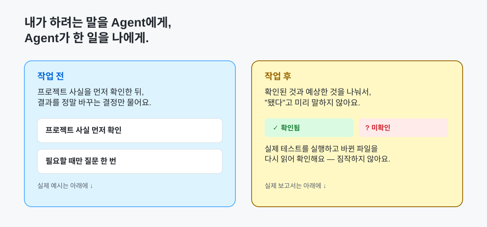
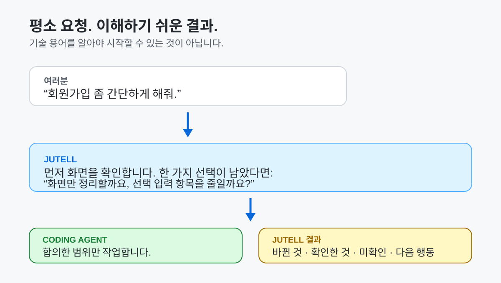
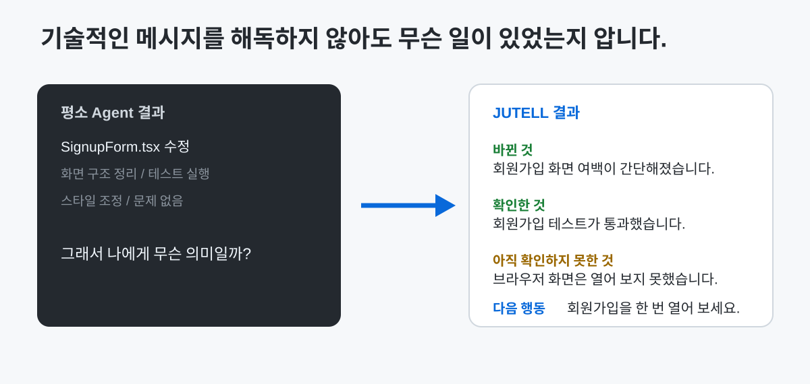
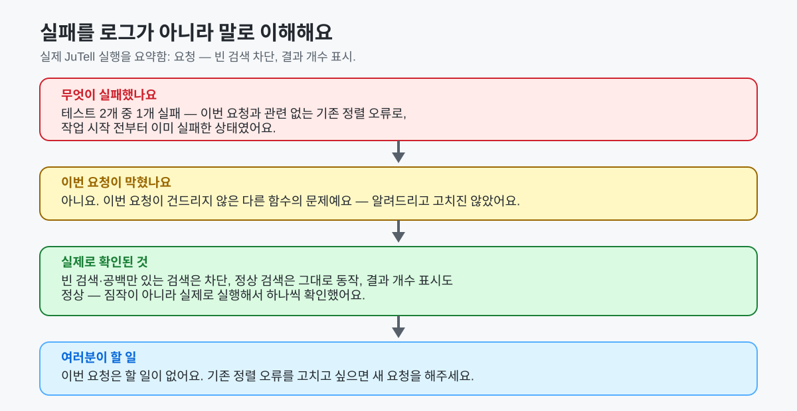
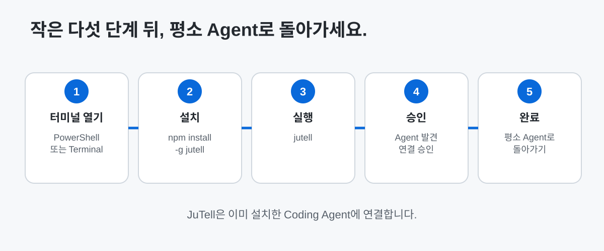

# JuTell — by Ju0

[English](README.md) | **한국어**

## AI Agent가 "다 했어요!"라고 하는데 — 정말 했을까요?

JuTell은 Coding Agent가 일을 마치면 한 페이지 **작업 영수증**을 보여 줘요. 내가 요청한 것, AI가
*했다고 말한* 것, 그리고 **Git이 실제로 본 변경**을 줄마다 출처 라벨과 함께 나눠 보여 줍니다.
코드나 로그를 읽을 필요가 없어요.


### 전 / 후 비교

| JuTell 없이 — Agent의 말만 | JuTell과 함께 — 작업 영수증 (실제 출력 일부) |
|---|---|
| *(흔한 Agent 답변 예시)*<br>"완료했어요! 로그인 버튼을 파란색으로 바꿨고 테스트도 모두 통과했어요. 🎉" | `[요청 대조]  요청 1개 중 1개 바뀐 곳 있음  [Git 기준 · 지도 대조]`<br>`→ 바뀐 곳 있음: src/pages/Login.tsx  [Git 기준 · 지도: 로그인]`<br>`✔ 직접 확인한 것: npm test 통과  [AI가 적음]`<br>`✖ 확인 못 한 것: 실제 화면은 브라우저로 보지 않음  [AI가 적음]`<br>`ⓘ 위 테스트·명령 결과는 AI가 알려 준 내용이에요. JuTell이 직접 돌려 보지는 않았어요  [JuTell이 적음]` |
| 그냥 믿거나, 직접 변경 내용을 읽어야 해요. | 확인된 것, AI 주장일 뿐인 것, 아직 확인 못 한 것이 한눈에 보여요. |

### 3단계로 시작하기

1. **설치** (Node.js 18 이상): `npm install -g jutell`
2. **프로젝트 폴더에서 실행:** `cd 내-프로젝트 && jutell` — 설치된 Agent(Codex, Claude Code, OpenCode)를 찾아 연결해요.
3. **평소처럼 Agent에게 요청**하세요(새 대화에서). 작업이 끝나면 JuTell 영수증이 나와요.

### 직접 보기 (실제 터미널 녹화, 편집 없음)

설정 → 작은 변경 → `jutell receipt`:


JuTell은 파일을 기능별로 묶은 프로젝트 지도 **JuTellMap.md**도 만들어요:




Linux에서 `npm install -g`가 `EACCES` 권한 오류로 실패하면 sudo 대신, npm 설치 위치를 홈 폴더로 바꾸거나(`npm config set prefix ~/.npm-global` 후 `~/.npm-global/bin`을 `PATH`에 추가) nvm으로 Node를 설치하세요.

JuTell은 해당 폴더에 `AGENTS.md`, `.agents/`, `.jutell.json`, `.jutell-local/`을 만들거나
업데이트합니다. Codex를 연결하면 `~/.codex/config.toml`에도 연결 설정을 추가합니다.

`jutell receipt`는 한 페이지 작업 영수증을 출력합니다.
`<project>/.jutell-local/reports/YYYY-MM-DD-HHmmss.md`에 저장하며, 파일명이 겹치면 `-2`, `-3` 등을 붙입니다.
JuTell은 `*`가 든 `.jutell-local/.gitignore`를 만들어 영수증을 Git에서 제외하며, 사용자의 `.gitignore`는 바꾸지 않습니다.
입력은 `.jutell-local/receipt.json`(읽은 뒤 삭제), `--file <path>` 또는 `--file -`(표준 입력)입니다.
끄려면 `.jutell.json`에서 `"features": { "receiptReport": false }`로 설정합니다.

대화형 입력이 없는 자동 실행에서는 `jutell --yes`를 사용하면 `(Y/n)` 확인을 건너뜁니다.

**설치는 하기 싫다면.** JuTell이 하는 일은 대부분 한 번의 연결이고, 끝나면 원래 쓰던 Agent로
돌려보내고 빠집니다. 그래서 설치 없이 바로 실행해도 됩니다:

```bash
npx jutell@latest
```

설치 파일은 안 남지만 연결 설정과 프로젝트 파일은 남습니다. npm 전역 폴더 권한 오류도
피할 수 있습니다.
Node.js는 어느 쪽이든 필요합니다.


JuTell은 여러분이 이미 쓰는 Coding Agent(Codex·Claude Code·OpenCode) 옆에서, 작업 전에는
프로젝트 사실을 확인하고 작업 후에는 확인된 것과 짐작한 것을 나눠 알려줍니다. Codex·Claude
Code·OpenCode를 제공하지 않고 AI 모델 자체도 아닙니다 — 자세한 내용은 아래
"JuTell이 하는 일과 하지 않는 일"에서 확인하세요.

## JuTell이 푸는 문제

AI Coding Agent 덕분에 코드를 쓰는 건 빨라졌지만, 그보다 오래된 문제 두 가지는 그대로
남았습니다.

- **작업 전:** 내가 정확히 뭘 원하는지 말로 설명하기 어렵고, Agent가 잘못 짐작하면 조용히
  엉뚱한 방향으로 작업이 진행될 수 있습니다.
- **작업 후:** Agent가 실제로 뭘 했는지 알기 어렵습니다. 잔뜩 쌓인 Diff와 "테스트했다"는
  한 문장만으로는 뭐가 진짜고 뭐가 짐작인지 구분되지 않습니다.

JuTell은 그 사이에 있습니다. Coding Agent를 대신하거나 코드를 직접 쓰지 않고, 그 코드를
둘러싼 대화를 양쪽 다 더 분명하게 만듭니다.

## 실제로 이렇게 동작해요



지어낸 대화가 아니라 실제 실행 결과를 요약한 것입니다 — 원문 전체는
[2.0.0 릴리스 쇼케이스](docs/releases/2.0.0-showcase.md)에 있습니다. JuTell이 무엇을 물었는지
보세요: 방금 읽은 실제 가입 화면을 근거로 한 질문 **한 가지**뿐입니다 — "무슨 뜻이에요?" 같은
막연한 질문이 아닙니다.

## Agent가 끝낸 뒤



JuTell은 실제로 확인한 경우에만 "확인됨"이라고 말합니다. 코드만 보고 예상한 것과 브라우저에서
아직 확인하지 못한 것은 항상 분명히 따로 표시합니다 — 전체 원문 보고서는
[릴리스 쇼케이스](docs/releases/2.0.0-showcase.md)에서 볼 수 있습니다.

## 뭔가 잘못됐을 때



각본이 아니라, 관련 없는 기존 테스트가 이미 깨져 있던 실제 실행에서 JuTell이 보인 실제
행동입니다. JuTell은 스스로를 완전한 자동 디버거라고 말하지 않습니다. 원문 로그를 읽게
하는 대신, 그 실패가 **여러분의 요청**에 무엇을 뜻하는지 설명합니다. 전체 원문:
[릴리스 쇼케이스](docs/releases/2.0.0-showcase.md).

## 아직 확인하지 못한 것도 있어요

화면이 실제 브라우저에서 정말 보기 좋은지처럼, 코드만 읽어서는 JuTell이 확인할 수 없는
것도 있습니다. 검색 결과 없음 문구의 스타일을 바꾼 실제 실행은 이렇게 정직하게 보고했습니다.

| | |
|---|---|
| 코드 확인 | ✅ 스타일 값이 실제로 바뀐 것을 확인함 |
| 테스트 확인 | ✅ 기존 테스트가 그대로 통과함 |
| 실제 화면 확인 | ❌ 확인 안 함 — 이번 환경에는 브라우저가 없었음 |
| 여러분이 할 일 | 화면을 한 번 열어 직접 봐 주세요. |

JuTell은 "코드로는 맞아 보인다"를 "화면에서 확인됐다"로 바꿔 말하지 않습니다. 브라우저를
실행하지 않았다면 그렇다고 말하고, 직접 봐 달라고 요청합니다.

## JuTell이 더 시키는 일은 얼마나 될까요?


이건 한 번 관찰한, 표본 1개짜리 비교일 뿐입니다 — JuTell이 항상 일정 배수의 토큰을 쓴다는
주장도, 토큰을 아껴준다는 주장도 아닙니다. 그 실행에서 늘어난 동작은 설정 읽기 1회, Skill
파일 읽기 1회, MCP 호출 1회였습니다. 전체 수치와 한계는
[릴리스 쇼케이스](docs/releases/2.0.0-showcase.md#efficiency-snapshot)에서 확인하세요. 이
오버헤드를 줄이는 것 — 특히 Skill 파일 전체 읽기부터 — 은 이미 끝난 일이 아니라 지금
진행 중인 작업입니다.

## 써 보세요

```bash
npm install -g jutell
jutell
```

위와 똑같은 두 명령이에요 — 여기까지 읽고 써 보고 싶으시다면, 필요한 건 이게 전부예요.

## 지원하는 Agent와 플랫폼

| 필요한 것 | 현재 상태 |
|---|---|
| **Codex** | 정식 지원 |
| **Claude Code** | 베타 |
| **OpenCode** | 베타 |
| Windows | 테스트됨 |
| Ubuntu | 제한적으로 테스트됨 |
| macOS | 사용 가능 / 미검증 |

먼저 Coding Agent가 필요합니다. JuTell은 이미 설치한 Agent에 연결하는 도구이며, Agent나 AI
모델 자체가 아닙니다.

## 설치 전에 준비할 것

다음이 필요합니다.

- **Coding Agent:** Codex, Claude Code 또는 OpenCode가 먼저 설치되어 있어야 합니다. Codex
  연결은 지원하며, Claude Code와 OpenCode는 베타입니다.
- **Node.js:** JuTell은 `npm`으로 설치합니다. npm은 Node.js에 함께 들어 있습니다. 없다면
  [nodejs.org](https://nodejs.org/en/download)에서 현재 Node.js를 설치하세요.
- **터미널:** Windows는 PowerShell, Ubuntu/macOS는 Terminal을 엽니다. 아래 두 명령을
  붙여넣는 창입니다.
- **인터넷 연결:** npm이 설치 중 JuTell을 내려받습니다.

## 설치 방법

위 두 명령을 이미 실행해 보셨나요? 여기서는 각 단계에서 실제로 무엇이 보여야 하는지, 뭔가
이상해 보일 때 무엇을 하면 되는지 — Ubuntu/Linux 권한 오류 해결법을 포함해서 — 자세히
설명합니다.



### 1단계 — PowerShell 또는 Terminal 열기

Windows에서는 시작 메뉴에서 **PowerShell**을 검색해 엽니다. Ubuntu 또는 macOS에서는
**Terminal**을 엽니다.

### 2단계 — JuTell 설치하기

아래를 붙여넣고 Enter를 누르세요.

```bash
npm install -g jutell
```

> **Ubuntu/Linux에서 권한 오류가 나나요?** `EACCES` / `permission denied` 오류가 나면, JuTell만의
> 문제가 아니라 Linux에서 흔한 npm 전역 폴더 소유권 문제입니다. `sudo npm install -g jutell`은
> 피하세요 — root 소유 파일이 남아 다음 설치에서 같은 문제를 반복시킬 수 있습니다. 안전한 해결
> 방법 두 가지는 [Ubuntu/Linux 설치 권한 오류](docs/CLI_INSTALLATION.md)에서 확인하세요.

### 3단계 — JuTell 실행하기

```bash
jutell
```

일반 설치 흐름을 한 번에 붙여넣어도 됩니다.

```bash
npm install -g jutell
jutell
```

### 4단계 — 발견된 Agent 연결 승인하기

JuTell은 컴퓨터에 이미 설치된 Codex·Claude Code·OpenCode를 찾습니다. 짧은 변경 안내를 읽고
연결할 Agent를 승인하세요. JuTell이 관리하는 설정만 다루며, 다른 Agent 설정은 그대로 둡니다.

### 5단계 — 평소 쓰던 Coding Agent로 돌아가기

설정은 터미널에서 끝납니다. 계속 열어 둬야 하는 새 대시보드는 없습니다. Codex·Claude
Code·OpenCode로 돌아가 평소처럼 사용하세요.

### 6단계 — 설치가 잘 된 모습

Agent를 찾고 연결했다는 안내가 오류 없이 보이면 됩니다. 짧은 연결 요약이 필요하면 `jutell
status`를 실행하세요. 문제가 보이면 `jutell doctor`가 다음에 할 일을 알려줍니다.

## 처음 해 볼 요청

바로 눈으로 확인할 수 있는 간단한 요청부터 해 보세요.

1. "로그인 버튼을 파란색으로 바꿔줘."
2. "회원가입 좀 간단하게 해줘."
3. "검색창이 비어 있으면 도움말을 보여줘."

첫 번째와 세 번째 요청은 Agent가 바로 작업해야 합니다. "회원가입 좀 간단하게 해줘"처럼
결과가 크게 달라질 수 있는 요청에서는, JuTell이 프로젝트를 먼저 확인하고 꼭 필요한 결정이
남을 때만 물어야 합니다. 기술적인 설문처럼 많은 질문을 하면 안 됩니다.

## 잘 작동하는지 어떻게 알 수 있나요?

```bash
jutell status
```

작은 연습 프로젝트에서 Codex만 설치된 채 `jutell --yes`를 실행한 직후의 실제 출력이에요(핵심 줄만 남김).
AI 세션이 실제로 JuTell을 읽었는지는 여기서 볼 수 없으니 짐작하지 않고 "직접 확인 필요"라고 보여줍니다.

```text
$ jutell status
JuTell 상태

CLI: 2.1.0
Skill: 설치됨
AGENTS.md: JuTell 블록 있음
JuTell 연결 정책: 켜짐
Codex MCP (전역, Codex는 프로젝트 설정을 읽지 않음): 활성화됨 (명령 감지됨)
OpenCode MCP: 미등록 (명령 미감지)
Claude Code MCP (현재 프로젝트(local)): 미등록 (명령 미감지)
MCP 서버 응답: 확인하지 않음
현재 Agent 세션 적용: 직접 확인 필요
Profile: balanced
설치 범위 (설정·Skill·AGENTS.md): 현재 프로젝트
Telemetry: 비활성화
외부 전송: 없음
지도: 지도가 최신이에요.
```

"설정됨"과 "실제로 확인함"을 나누기 때문에, 아직 도구를 호출해 보지 않은 상태를 오류처럼
보여주지 않습니다.

```bash
jutell doctor
```

설치가 이상해 보일 때 사용하세요. JuTell 파일·설정·권한·컴퓨터 밖으로 전송될 내용이 있는지를
한 줄씩 점검하며, 각 줄을 정상·오류·직접 확인 필요로 표시합니다. 기본 출력에는 전체 경로나
비밀 값을 보여주지 않습니다.

## 처음 써 보는 분을 위한 실제 화면

아래 화면은 모두 **실제로 실행해서 나온 그대로**입니다. 작은 연습용 Git 프로젝트(파일 5개)에서
Codex만 깔린 환경으로 실행했어요. 날짜·시각·파일 이름은 여러분 컴퓨터에서 다르게 나옵니다.

**한 줄 설치** — 터미널에 붙여 넣으세요. (Node.js 18 이상이 필요해요.)

```bash
npm install -g jutell && jutell
```

**처음 실행했을 때** (`jutell` 화면 중 일부):

```text
찾은 Coding Agent:

Codex        찾음
OpenCode     미감지
Claude Code  미감지
...
JuTell을 지금 연결할까요? (Y/n)
...
JuTell 준비 완료.

✓ Codex 연결됨

새 Coding Agent 세션을 열고 평소처럼 사용하세요.
...
프로젝트 지도(JuTellMap.md)를 만들까요? 파일이 어디 있는지 기능별로 정리해요. (Y/n)
프로젝트 지도(JuTellMap.md)를 만들었어요. 파일 7개, 분류 안 된 파일 4개.
보기 쉬운 화면: .jutell-local/map.html
```

질문은 두 번 나와요: 연결할지, 그리고 프로젝트 지도를 만들지. 둘 다 Enter를 누르면 "예"예요.

"준비 완료." 대신 **"JuTell 준비됨, 하나 확인 필요."**가 나오면, 바로 위 ⚠ 줄을 읽어 보세요. 대부분은
Codex가 `jutell` 명령을 찾지 못하는 경우라 `jutell doctor`가 고치는 법을 한 가지 알려 줘요.

영수증은 AI가 알아서 만들어요. 작업이 끝나면 AI 답 맨 위에 붙어 나오니 `jutell receipt`를 직접 칠 필요는 없어요.

이미 연결된 뒤 `jutell`을 다시 치면 상태만 짧게 보여 줘요. 관리 화면은 `jutell dashboard`로 브라우저에서 열어요. 꺼 두었거나 고칠 게 있으면 터미널에서 다시 켤지 물은 뒤 관리 화면이 브라우저로 열려요.

**프로젝트 지도 예시** — 프로젝트 폴더에 생기는 `JuTellMap.md`의 앞부분입니다. AI가 "로그인 고쳐 줘" 같은
말을 어느 파일과 연결할지 이 지도를 보고 정합니다. `[지도로 짐작]`은 파일 이름으로 짐작했다는 뜻이고,
설명은 마음대로 고쳐도 됩니다. (아래는 실제로 만든 지도이고, 파일 안의 자동 칸 표시 줄만 생략했어요.)

```text
# JuTell 지도 — 이 프로젝트는 어떻게 생겼나요?
표와 목록은 JuTell이 자동으로 다시 채워요. 설명 글은 마음대로 고쳐도 되지만, 숨은 칸 표시(HTML 주석)는 지우지 마세요.
마지막 갱신: 2026-10-24 14:17 (UTC+0) · 파일 7개 · 분류 안 된 파일 4개 · 목록 기준 Git 파일 목록

## 할 일 [지도로 짐작]
- src/api/todos.ts — 기능
- src/components/TodoList.tsx — 화면

## 로그인 [지도로 짐작]
- src/pages/Login.tsx — 화면

## 아직 분류 안 된 파일
설명: 아래 줄을 원하는 기능 칸으로 옮기면, 다음부터 그 칸에 둡니다.
- .jutell.json — 설정
- AGENTS.md — 문서
- README.md — 문서
- package.json — 설정
```

`jutell map --list`로 터미널에서도 볼 수 있어요.

**작업 영수증 예시** — AI가 "로그인 버튼을 파란색으로" 작업을 끝낸 뒤 만든 영수증입니다.
`[AI가 적음]`은 AI가 스스로 한 말, `[Git 기준]`은 JuTell이 실제 파일 변화를 보고 확인한 것이에요.
둘이 다르면 Git 기준을 믿으세요. `ⓘ` 줄은 JuTell이 덧붙인 안내라 `[JuTell이 적음]`이 붙어요.
(아래는 임시 프로젝트에서 `jutell --yes`와 `jutell receipt`를 실제로 실행한 출력입니다.)

```text
==============================
  JuTell 작업 영수증
  2026-10-24 14:17
==============================
[요청 대조]  요청 1개 중 1개 바뀐 곳 있음  [Git 기준 · 지도 대조]
 1. 로그인 버튼을 파란색으로  [AI가 적음]
    → 바뀐 곳 있음: src/pages/Login.tsx  [Git 기준 · 지도: 로그인]

[이번에 한 작업]  [AI가 적음]
 1. 로그인 버튼을 파란색으로 바꿨어요

[바뀐 파일]  [Git 기준]
 1. src/pages/Login.tsx

[확인]  [AI가 적음 · JuTell이 적은 줄은 따로 표시]
 ✔ 직접 확인한 것: Login.tsx에 파란색 클래스가 들어간 것을 확인  [AI가 적음]
 ✔ 직접 확인한 것: `npm test` 실행해서 3개 통과  [AI가 적음]
 ✖ 확인 못 한 것: 브라우저 화면은 열어 보지 않음  [AI가 적음]
 ⓘ 위 테스트·명령 결과는 AI가 알려 준 내용이에요. JuTell이 직접 돌려 보지는 않았어요  [JuTell이 적음]
------------------------------
[다음 추천]  [AI가 적음]
 ○ 추천  [AI가 적음]
   - 브라우저에서 색이 맞는지 직접 봐 주세요  [AI가 적음]
------------------------------
 저장됨: .jutell-local/reports/2026-10-24-141734.md  [JuTell이 적음]
==============================
한 줄 요약: 로그인 버튼을 파란색으로 바꿨어요  [AI가 적음] · 요청 1개 중 1개 처리  [Git 기준]
```

영수증은 `.jutell-local/reports/` 폴더에 파일로도 남습니다.

## 문제가 생겼나요?

| 이런 경우 | 이렇게 해 보세요 |
|---|---|
| Agent를 찾지 못함 | 지원되는 Coding Agent를 설치하고 열어 본 뒤 `jutell`을 다시 실행하세요. |
| 연결에 실패함 | `jutell doctor`를 실행하고 안내를 따르세요. |
| 한 Agent를 다시 연결하고 싶음 | `jutell`을 다시 실행하거나, 아래 고급 수동 연결 명령을 사용하세요. |
| JuTell을 끄고 싶음 | `jutell off --yes`를 실행하세요. MCP 연결을 끄고, 설정과 `.jutell-local`의 기록(작업 영수증·지도·Beta Journal 하루 작업 기록)은 남겨요. |
| JuTell을 지우고 싶음 | `jutell uninstall --yes`를 실행하세요. `--remove-data`를 직접 추가하지 않는 한 로컬 데이터는 남습니다. |
| 무엇이 잘못됐는지 모르겠음 | `jutell doctor`를 실행하세요. 줄마다 `정상`·`주의`·`오류`가 붙고, `오류` 줄에 고치는 방법이 바로 적혀 있습니다. |
| 영수증이 안 생김 / "jutell 명령을 찾을 수 없음"(command not found) | `jutell doctor`의 "Codex에서 jutell 명령 찾기" 줄을 보세요. 전역 설치(`-g`)라면 안내대로 PATH 한 줄을 넣고 터미널과 Agent를 다시 여세요. 프로젝트에만 설치했다면 `npm exec --offline --no -- jutell receipt`처럼 앞에 `npm exec --offline --no --`를 붙이면 됩니다. npm workspaces의 멤버 폴더라면 `npm exec --offline --no --prefix . -- jutell receipt`처럼 `--prefix .`를 붙여 그 멤버 폴더에서 실행하세요(작업 공간 루트에서 실행하면 루트가 대상이 됩니다). 나중에 설치 방식을 바꿨다면(프로젝트 안 ↔ 컴퓨터 전체) doctor가 `주의`로 알려 주고, 프로젝트 폴더에서 `jutell --yes`를 한 번 더 실행하면 AGENTS.md/CLAUDE.md의 영수증 명령이 지금 설치에 맞게 고쳐집니다("…영수증 명령을 지금 설치에 맞게 고쳤어요"). |
| 지웠는데 파일이 남아 있음 | 정상입니다. `jutell uninstall --yes`는 설정(`.jutell.json`), 작업 기록·영수증(`.jutell-local/`), 지도(`JuTellMap.md`)를 일부러 남기고 화면에 "남겨 둔 것"으로 알려 줍니다. 모두 지우려면 `jutell uninstall --remove-data --yes` 뒤 `JuTellMap.md`를 직접 지우세요. Codex 연결은 모든 프로젝트가 함께 쓰므로 `jutell uninstall --global --yes`로 따로 지웁니다. |
| Ubuntu/Linux에서 설치 중 `EACCES`/권한 오류가 남 | [Ubuntu/Linux 설치 권한 오류](docs/CLI_INSTALLATION.md)를 확인하세요. `sudo npm install -g jutell`은 피하세요. |

## JuTell이 하는 일과 하지 않는 일

**JuTell이 하는 일:**
- Coding Agent 옆에서 함께 일하는 소통 레이어
- 작업 전, 결과를 바꾸는 진짜 의도를 분명하게 하는 것
- 작업 후, 실제로 한 일과 근거를 설명하는 것

**JuTell이 하지 않는 일:**
- AI 모델 자체가 되는 것
- Coding Agent를 대신하는 것
- 코드가 맞다고 보증하는 것
- 완전한 자동 디버거가 되는 것
- 여러 Agent를 지휘하는 오케스트레이터가 되는 것

**무엇이 바뀌었는지**, **무엇을 확인했는지**, **코드만 보고 예상한 것은 무엇인지**, **아직
확인하지 못한 것은 무엇인지**를 섞지 않습니다. Agent 결과가 맞다고 보증하지 않고, 모든
의존성을 찾는다고 약속하지 않으며, 브라우저 동작을 자동으로 확인하지도, 승인 여부를 대신
결정하지도 않습니다.

## 신뢰와 개인정보

JuTell은 여러분 컴퓨터에 이미 있는 파일·Git·명령 결과를 바탕으로 작업을 설명합니다. 프로젝트
코드, Prompt, Agent 원문 답변, Diff, 비밀정보를 수집하거나 외부로 보내지 않습니다. Telemetry는
기본으로 꺼져 있으며, 이 단계에서는 저장이나 외부 전송도 구현되어 있지 않습니다.

자세한 내용은 [개인정보 원칙](docs/PRIVACY_PRINCIPLES.md)을, 제품의 전체 범위와 한계는
[제품 범위](docs/PRODUCT_SCOPE.md)에서 확인하세요.

## 최신 소식

**`jutell@2.1.0`**이 npm에 공개됐어요(2026-10-24). 이제 작업이 끝난 뒤뿐 아니라 시작하기 전에도
돕습니다. 프로젝트 사실을 먼저 확인하고, 진짜 결정만 물으며, 확인됨 / 예상 / 미확인을 섞지
않습니다.

실제 보고서, 실제 실패 사례, 정직한 효율 스냅샷, 이번 릴리스의 알려진 한계는
[2.0.0 릴리스 쇼케이스](docs/releases/2.0.0-showcase.md)에서 확인하세요 — 마케팅 문구가 아니라
실제 출력 그대로입니다.

## 설치·제어·고급 명령

### Agent별로 직접 연결하기 (Codex · Claude Code · OpenCode)

보통은 `jutell` 한 번이면 컴퓨터에 있는 Agent를 찾아 알아서 연결합니다. 하나만 골라 다시 연결하고 싶을 때
프로젝트 폴더에서 아래 중 하나를 실행하세요. 연결한 뒤에는 그 Agent에서 **새 대화**를 열어야 적용됩니다.

| Agent | 명령 | 알아 둘 점 |
|---|---|---|
| Codex (권장) | `jutell use codex` | Codex는 연결 정보를 모든 프로젝트가 함께 쓰는 `~/.codex/config.toml`에서 읽어서, 그 파일에 JuTell 연결 한 부분만 넣습니다. 다른 설정은 건드리지 않아요. |
| Claude Code (베타) | `jutell use claude` | Claude Code 설정 파일(`~/.claude.json`) 안의 이 프로젝트 칸에만 연결합니다. |
| OpenCode (베타) | `jutell use opencode` | 이 프로젝트 폴더의 `opencode.json`에 연결합니다. |

연결이 됐는지는 `jutell doctor`에서 `Codex MCP` / `Claude Code MCP` / `OpenCode MCP` 줄이 `정상`인지 보면 됩니다.

### 자주 쓰는 명령

| 명령 | 하는 일 |
|---|---|
| `jutell` | 설치된 지원 Agent를 찾아 연결할지 물어봅니다. |
| `jutell status` | 설치·연결·Profile·Feature 상태를 보여줍니다. |
| `jutell doctor` | 설치 문제를 점검합니다. |
| `jutell on` / `jutell off --yes` | JuTell 연결을 켜거나 끕니다(`off`는 터미널에서는 먼저 묻고, 물을 수 없으면 `--yes` 없이는 진행하지 않아요). |
| `jutell setup` | Skill·기본 설정·MCP 연결을 다시 준비합니다. |
| `jutell provider` | Agent별 연결 상태를 자세히 보여줍니다. |
| `jutell upgrade` | 설치된 Skill/설정/MCP를 최신 버전으로 새로고침합니다. |
| `jutell uninstall` | JuTell이 관리하는 설정을 제거합니다. |

MCP는 Coding Agent가 JuTell을 더 직접적으로 사용할 수 있게 하는 선택형 로컬 연결입니다.
일반 설치에는 MCP를 이해하거나 직접 설정할 필요가 없습니다. MCP가 꺼져 있어도 JuTell의
보고 방식은 계속 사용할 수 있습니다. 기술적인 내용은 [CLI 설치 안내](docs/CLI_INSTALLATION.md)와
[MCP 연결](docs/MCP_INTEGRATION.md)을 참고하세요.

CLI가 만들어 주는 프로젝트의 `.jutell.json`으로 보고 방식을 조절할 수 있습니다. `minimal`,
`balanced`, `learning`, `detailed` Profile은 설명 길이만 바꾸며, 사실이나 위험 판단을 바꾸지
않습니다.

npm이 아니라 저장소 소스를 직접 검증하는 기여자라면 `packages/cli`에서 `npm pack`을
실행했을 때 `jutell-2.1.0.tgz`가 만들어집니다. 일반 사용자는 이 경로가 필요 없습니다.

기여자용 문서: [Changelog](CHANGELOG.md) · [문서 지도](docs/DOCUMENTATION_MAP.md) ·
[OpenCode 연결](docs/PROVIDER_OPENCODE.md) ·
[GitHub Releases](https://github.com/ju0o/jutell/releases)

## JuTell 후원하기

JuTell은 무료이고 MIT 라이선스이며, 앞으로도 그렇습니다.

시간을 아끼셨다면 커피 한 잔 사주실 수 있습니다. 다음 provider와 다음 수정에 쓰입니다.

[](https://ko-fi.com/ju0o___)

후원하지 않아도 달라지는 건 없습니다. 모든 기능은 누구에게나 그대로 열려 있습니다.

## JuTell by Ju0

Ju0는 상위 브랜드이며 JuTell은 그 제품입니다.

[](https://www.npmjs.com/package/jutell)
[](LICENSE)
[](https://nodejs.org)
