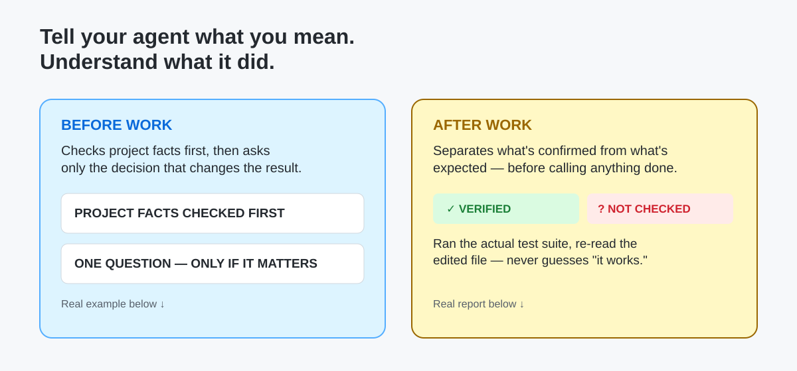
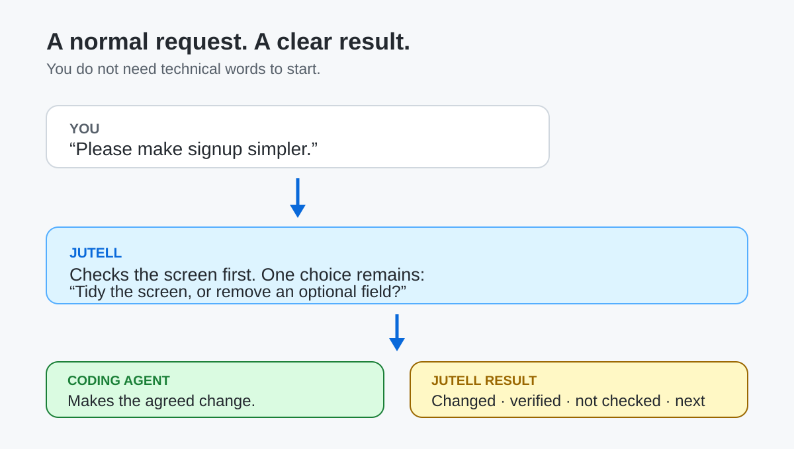
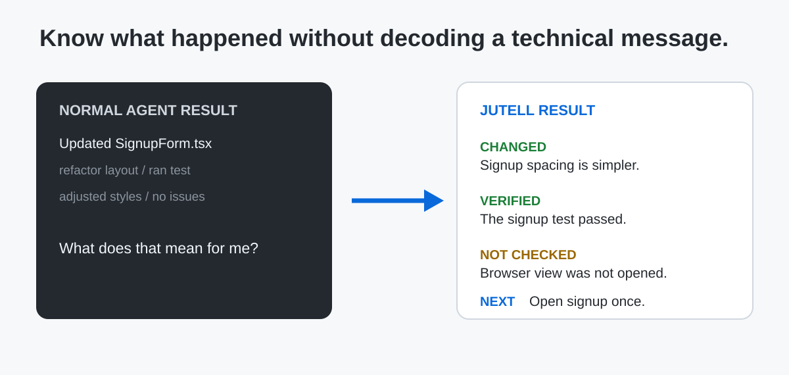
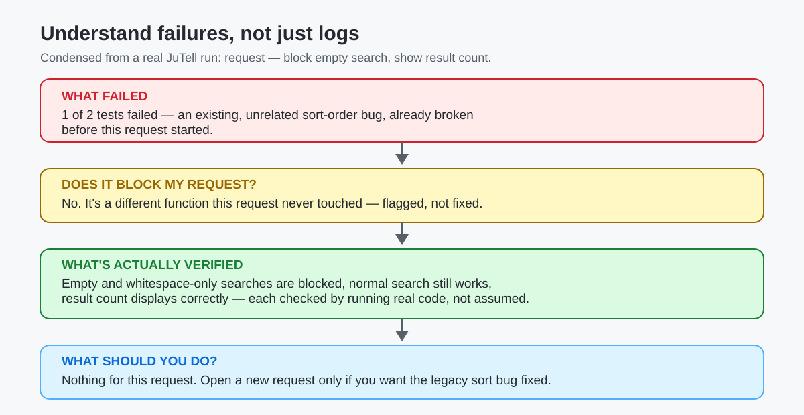
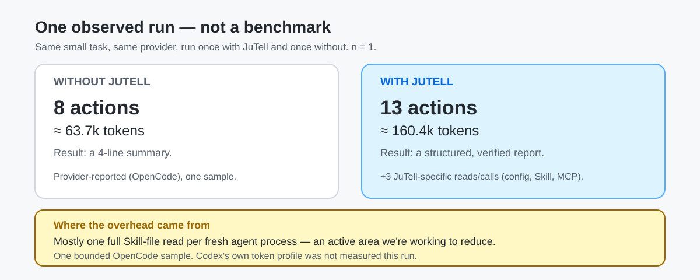
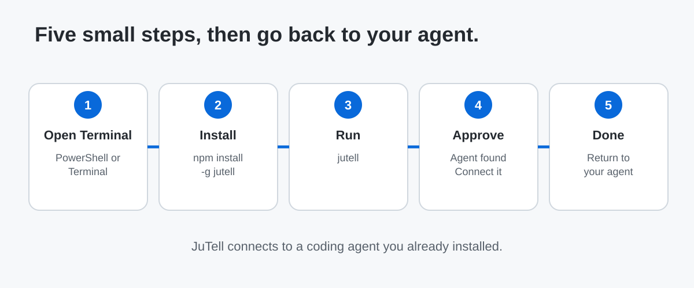

# JuTell — by Ju0

**English** | [한국어](README.ko.md)

[](https://github.com/ju0o/jutell/actions/workflows/ci.yml)
[](https://www.npmjs.com/package/jutell)
[](LICENSE)
[](https://nodejs.org)

## Your AI agent says "Done!" — but did it really?

JuTell does two things for you, with no code or logs to read:

- **A project map, made and kept up to date automatically.** JuTell writes `JuTellMap.md` at your
  project root — your files grouped by feature (login, payment, api…) — plus an easy-to-read page at
  `.jutell-local/map.html`. It is created when you set JuTell up, refreshed every time your agent
  finishes with a receipt (new and deleted files are added/removed; your own notes are kept), and you
  can refresh it any time with `jutell map`.
- **A one-page receipt after your agent works:** what you asked for, what the AI *says* it did, and
  what **Git actually saw change** — each line labeled so you know who is speaking.


### Before / after

| Without JuTell — the agent's own words | With JuTell — the receipt (real output, trimmed) |
|---|---|
| *(a typical agent reply, for illustration)*<br>"Done! I updated the login button to blue and all tests pass. 🎉" | `[요청 대조]` request check — 1 of 1 requests has a change `[Git 기준]` (checked by Git)<br>`→ 바뀐 곳 있음` changed: `src/pages/Login.tsx`<br>`✔` checked: `npm test` passed `[AI가 적음]` (AI's claim)<br>`✖` not checked: screen not viewed in a browser<br>`ⓘ` test results come from the AI; JuTell did not run them `[JuTell이 적음]` |
| *"Where is the payment code? What did it touch?"* — you dig through folders. | **Project map** — `JuTellMap.md` / `map.html`: `결제` (payment) → `src/pages/Checkout.tsx`, `src/payment/charge.ts`, `src/payment/refund.ts`, `tests/payment.test.ts`; the receipt links each change to a map feature (`[지도: 로그인]` = map: login). |
| You have to trust it — or read the diff yourself. | You see what's verified, what's only claimed, and what's still unchecked. |

### Start in 3 steps

1. **Install** (Node.js 18+): `npm install -g jutell`
2. **Run it in your project folder:** `cd your-project && jutell` — it finds your agent (Codex, Claude Code, OpenCode) and connects it.
3. **Open your project map** — `.jutell-local/map.html` in a browser (or `JuTellMap.md`) — then
   **ask your agent as usual** in a new session. When it finishes, it prints a JuTell receipt and the
   map is refreshed.

### See it (real terminal recording, unedited)

Setup → a small change → `jutell receipt`. The output is in Korean; the labels are glossed below.


**The project map in your browser** (`.jutell-local/map.html`, real page generated by `jutell map`
in a small demo shop project; screenshots from headless Chrome, cards opened one by one). Labels:
`화면` screen · `코드` code · `테스트` tests · `[지도로 짐작]` guessed from file names ·
`아직 분류 안 된 파일` not yet sorted.


The same map in the terminal — `JuTellMap.md` and `jutell map --list`:


Label glossary: `[AI가 적음]` = written by the AI · `[Git 기준]` = checked against Git ·
`[지도 …]` = matched with the project map · `[JuTell이 적음]` = JuTell's own note ·
`영수증` = receipt · `확인 못 한 것` = not checked yet.



Linux `EACCES` permission error on `npm install -g`? Don't use sudo; point npm at a folder in your home (`npm config set prefix ~/.npm-global` and add `~/.npm-global/bin` to `PATH`) or install Node with nvm.

## Two key features

JuTell's terminal output is written in Korean for now. The examples below are real, unedited output
from running `jutell --yes` and then `jutell receipt` in a small temporary Git project.

### 1. A plain-language work receipt

When your agent finishes, it runs `jutell receipt`. JuTell prints a one-page receipt and saves it in
`.jutell-local/reports/`. Every line says who it comes from:

| Label | Meaning |
|---|---|
| `[AI가 적음]` | Written by the AI agent (its own claim) |
| `[Git 기준]` | Checked by JuTell against the real file changes in Git |
| `[지도 대조]` / `[지도: …]` | Matched against the project map (feature 2) |
| `[JuTell이 적음]` | A note written by JuTell itself, such as the `ⓘ` line |

If the AI's words and Git disagree, trust Git. The `ⓘ` line below is JuTell pointing out that the
test result is only what the AI reported; JuTell did not run the tests itself.

```text
==============================
  JuTell 작업 영수증
  2026-10-24 14:17
==============================
[요청 대조]  요청 1개 중 1개 바뀐 곳 있음  [Git 기준 · 지도 대조]
 1. 로그인 버튼을 파란색으로  [AI가 적음]
    → 바뀐 곳 있음: src/pages/Login.tsx  [Git 기준 · 지도: 로그인]

[이번에 한 작업]  [AI가 적음]
 1. 로그인 버튼을 파란색으로 바꿨어요

[바뀐 파일]  [Git 기준]
 1. src/pages/Login.tsx

[확인]  [AI가 적음 · JuTell이 적은 줄은 따로 표시]
 ✔ 직접 확인한 것: Login.tsx에 파란색 클래스가 들어간 것을 확인  [AI가 적음]
 ✔ 직접 확인한 것: `npm test` 실행해서 3개 통과  [AI가 적음]
 ✖ 확인 못 한 것: 브라우저 화면은 열어 보지 않음  [AI가 적음]
 ⓘ 위 테스트·명령 결과는 AI가 알려 준 내용이에요. JuTell이 직접 돌려 보지는 않았어요  [JuTell이 적음]
------------------------------
[다음 추천]  [AI가 적음]
 ○ 추천  [AI가 적음]
   - 브라우저에서 색이 맞는지 직접 봐 주세요  [AI가 적음]
------------------------------
 저장됨: .jutell-local/reports/2026-10-24-141734.md  [JuTell이 적음]
==============================
한 줄 요약: 로그인 버튼을 파란색으로 바꿨어요  [AI가 적음] · 요청 1개 중 1개 처리  [Git 기준]
```

### 2. JuTellMap — a feature map of your project

On first run, JuTell writes `JuTellMap.md`, which groups your files by feature (for example,
"로그인" = login, "할 일" = to-do). The agent uses it to connect a request like "fix the login" to the
right files, and the receipt uses it to check whether the requested feature was actually touched.
`[지도로 짐작]` means "guessed from file names". You can freely edit the descriptions, or move lines
into a different section. This is the real map from the same run; only the hidden auto-section
marker lines are omitted. `jutell map --list` shows it in the terminal, and
`.jutell-local/map.html` is an easy-to-read view.

```text
# JuTell 지도 — 이 프로젝트는 어떻게 생겼나요?
표와 목록은 JuTell이 자동으로 다시 채워요. 설명 글은 마음대로 고쳐도 되지만, 숨은 칸 표시(HTML 주석)는 지우지 마세요.
마지막 갱신: 2026-10-24 14:17 (UTC+0) · 파일 7개 · 분류 안 된 파일 4개 · 목록 기준 Git 파일 목록

## 할 일 [지도로 짐작]
- src/api/todos.ts — 기능
- src/components/TodoList.tsx — 화면

## 로그인 [지도로 짐작]
- src/pages/Login.tsx — 화면

## 아직 분류 안 된 파일
설명: 아래 줄을 원하는 기능 칸으로 옮기면, 다음부터 그 칸에 둡니다.
- .jutell.json — 설정
- AGENTS.md — 문서
- README.md — 문서
- package.json — 설정
```

**Quick start**

First, go to your project folder:

```bash
cd /path/to/your-project
```

```bash
npm install -g jutell
jutell
```

JuTell creates or updates `AGENTS.md`, `.agents/`, `.jutell.json`, and `.jutell-local/` in that
folder. When you connect Codex, it also adds connection settings to `~/.codex/config.toml`. The ChatGPT desktop app (Codex app) and the Codex IDE extension share that same file, so connecting Codex once covers all three; after it, restart the app (Settings → MCP servers → Restart) or the IDE extension (Restart extension).

Run `jutell receipt` to print a one-page work receipt and save it at
`<project>/.jutell-local/reports/YYYY-MM-DD-HHmmss.md` (`-2`, `-3`, etc. handle name collisions).
JuTell creates `.jutell-local/.gitignore` containing `*`; this keeps receipts out of Git without changing your `.gitignore`.
Input comes from `.jutell-local/receipt.json` (deleted after reading), `--file <path>`, or `--file -` (stdin).
Set `"features": { "receiptReport": false }` in `.jutell.json` to turn off receipt reports.

For non-interactive or automated runs, use `jutell --yes` to skip the `(Y/n)` prompt.

**Don't want to install anything?** JuTell's normal job is a one-time connection - it hands you
back to your own agent and gets out of the way - so you can just run it without installing:

```bash
npx jutell@latest
```

No install files are left, but the connection settings and project files remain; it also sidesteps
npm's global-folder permission errors entirely. Node.js is still required either way.

JuTell sits beside a coding agent you already use — Codex, Claude Code, or OpenCode — checking
project facts before work and separating verified from assumed after it. It does not provide
Codex, Claude Code, or OpenCode, and it is not an AI model itself (more on what JuTell is and
isn't, further down).

## The problem JuTell solves

AI coding agents made writing code faster. They didn't fix two older problems:

- **Before work:** it's hard to explain exactly what you mean, and an agent that guesses wrong
  can quietly do the wrong thing.
- **After work:** it's hard to tell what an agent actually did — a wall of diffs and "I tested it"
  don't tell you what's real and what's assumed.

JuTell sits in that gap. It doesn't replace your coding agent or write code itself — it makes the
conversation around the code clearer, on both ends.

## See it in action



This is condensed from an actual run, not invented dialogue — the full raw output is in the
[2.0.0 release showcase](docs/releases/2.0.0-showcase.md). Notice what JuTell asked: **one**
question, grounded in the real form it had just read — not a generic "what do you mean?"

## After your agent finishes



JuTell does not call something "verified" unless it actually checked it. A code-based expectation
and an unchecked browser result stay clearly labeled, every time — see the full raw report in the
[release showcase](docs/releases/2.0.0-showcase.md).

## When something goes wrong



This is JuTell's real behavior on a run where a pre-existing, unrelated test was already broken —
not a scripted demo. JuTell doesn't claim to be a full autonomous debugger; it explains what a
failure means for **your** request instead of leaving you to read raw test output. Full raw output:
[release showcase](docs/releases/2.0.0-showcase.md).

## When something can't be checked yet

Some things — like whether a screen actually looks right in a real browser — JuTell cannot confirm
by reading code alone. A real run that changed an empty-search message's styling reported it
honestly:

| | |
|---|---|
| Code checked | ✅ the style values actually changed |
| Test checked | ✅ the existing test still passed |
| Real browser view | ❌ not checked — no browser was available |
| Your action | Open the screen once and look. |

JuTell does not turn "looks right in code" into "confirmed on screen." If it didn't run a browser,
it says so, and asks you to look.

## What extra work does JuTell add?



This is one bounded, single-sample comparison — not a claim that JuTell always costs a fixed
multiple of tokens, and not a claim that it saves tokens either. The extra actions in that run were
a config read, a Skill-file read, and one MCP call. Full numbers and caveats:
[release showcase](docs/releases/2.0.0-showcase.md#efficiency-snapshot). Reducing that overhead —
starting with the full Skill-file read — is an active area of work, not something already solved.

## Try it

```bash
npm install -g jutell
jutell
```

The same two commands as above — if you've read this far and want to try it, this is all it takes.

## Supported agents & platforms

| What you need | Current status |
|---|---|
| **Codex** | Supported |
| **Claude Code** | Beta |
| **OpenCode** | Beta |
| Windows | Tested |
| Ubuntu | Limited testing |
| macOS | Available / unverified |

You need a coding agent first. JuTell connects to an agent you already installed; it is not the
agent or the AI model itself.

## Before installing

You need:

- **A coding agent:** Codex, Claude Code, or OpenCode already installed. Codex is the fully
  supported connection; Claude Code and OpenCode are Beta.
- **Node.js:** JuTell is installed with `npm`, which comes with Node.js. If you do not have it,
  install the current Node.js release from [nodejs.org](https://nodejs.org/en/download).
- **A terminal:** PowerShell on Windows, or Terminal on Ubuntu/macOS. It is just the place where
  you paste the two commands below.
- **Internet access:** npm downloads JuTell during installation.

## Install, step by step

Already ran the two commands above? Here's exactly what should happen at each step, plus what to
do if something looks wrong — including the Ubuntu/Linux permission fix.



### Step 1 — Open PowerShell or Terminal

On Windows, search for **PowerShell** and open it. On Ubuntu or macOS, open **Terminal**.

### Step 2 — Install JuTell

Paste this, then press Enter:

```bash
npm install -g jutell
```

> **Permission error on Ubuntu/Linux?** If this fails with `EACCES` / `permission denied`, it's a
> common npm global-folder ownership issue on Linux, not something specific to JuTell. Avoid
> `sudo npm install -g jutell` — it can leave root-owned files that cause the same problem again
> later. See [Ubuntu/Linux install permission error](docs/CLI_INSTALLATION.md) for two safe fixes.

### Step 3 — Run JuTell

```bash
jutell
```

Or paste the normal install path together:

```bash
npm install -g jutell
jutell
```

### Step 4 — Approve the detected agent connection

JuTell looks for Codex, Claude Code, and OpenCode that are already on your computer. Read the short
preview and approve the connection you want. It only manages JuTell's own setup blocks and keeps
other agent settings in place.

### Step 5 — Return to your normal coding agent

Setup finishes in the terminal. There is no new dashboard you must keep open. Go back to Codex,
Claude Code, or OpenCode and use it as usual.

### Step 6 — What successful setup looks like

Setup asks two questions: `JuTell을 지금 연결할까요? (Y/n)` ("Connect JuTell now?") and
`프로젝트 지도(JuTellMap.md)를 만들까요? 파일이 어디 있는지 기능별로 정리해요. (Y/n)` ("Create the project map?").
Press Enter for yes.

If it ends with `JuTell 준비됨, 하나 확인 필요.` ("Ready, one thing to check") instead of `JuTell 준비 완료.`, read
the ⚠ line just above it. Usually Codex cannot find the `jutell` command; `jutell doctor` shows the one fix.

영수증은 AI가 알아서 만들어요 — the agent makes the receipt by itself at the end of its answer; you never need to type `jutell receipt`.

Running `jutell` again once everything is connected only prints a short status; open the admin screen in your browser with `jutell dashboard`. If JuTell was turned off or needs a fix, an interactive run asks to turn it back on and then opens the admin screen in the browser.

You should see that an agent was found and connected, without an error. Then run `jutell status` if
you want a short connection summary. If it says there is a problem, run `jutell doctor` for the
next step to take.

## First things to try

Start with a request you can recognize easily:

1. "Change the login button to blue."
2. "Please make signup simpler."
3. "Make the empty search box show a helpful message."

For the first and third, JuTell should let your agent get on with a clear request. For "make signup
simpler," it should check the project first and ask only if a real choice remains. It should not
turn your request into a technical questionnaire.

## How do I know it is working?

```bash
jutell status
```

Real output (the CLI speaks Korean) from a small practice project right after `jutell --yes`
with only Codex installed, trimmed to the key lines:

```text
$ jutell status
JuTell 상태

CLI: 2.1.0
Skill: 설치됨
AGENTS.md: JuTell 블록 있음
JuTell 연결 정책: 켜짐
Codex MCP (전역, Codex는 프로젝트 설정을 읽지 않음): 활성화됨 (명령 감지됨)
OpenCode MCP: 미등록 (명령 미감지)
Claude Code MCP (현재 프로젝트(local)): 미등록 (명령 미감지)
MCP 서버 응답: 확인하지 않음
현재 Agent 세션 적용: 직접 확인 필요
Profile: balanced
설치 범위 (설정·Skill·AGENTS.md): 현재 프로젝트
Telemetry: 비활성화
외부 전송: 없음
지도: 지도가 최신이에요.
```

"MCP 서버 응답: 확인하지 않음" means "MCP server response: not checked", and "현재 Agent 세션 적용:
직접 확인 필요" means "applied to the current agent session: confirm it yourself".

It separates "configured" from "actually checked," so an untested tool call is not presented as a
failure.

```bash
jutell doctor
```

Use this when setup looks wrong. It checks JuTell files, configuration, permissions, and whether
anything would be sent outside your computer, line by line, each marked OK, error, or needs a
closer look. Its normal output avoids showing full paths or secret values.

## Something went wrong

| If this happens | Try this |
|---|---|
| No agent was found | Install and open a supported coding agent first, then run `jutell` again. |
| Connection failed | Run `jutell doctor`, then follow its message. |
| You want to reconnect one agent | Run `jutell` again, or use the manual connection commands in Advanced. |
| You want to turn JuTell off | Run `jutell off --yes`. It turns off the MCP connection; your settings and the records in `.jutell-local` (receipts, map, Beta Journal) stay. |
| You want to remove JuTell | Run `jutell uninstall --yes`. It keeps local data unless you explicitly add `--remove-data`. |
| `EACCES` / permission denied installing on Ubuntu/Linux | See [Ubuntu/Linux install permission error](docs/CLI_INSTALLATION.md). Avoid `sudo npm install -g jutell`. |

## What JuTell is — and is not

**JuTell is:**
- a communication layer beside your coding agent
- something that helps clarify material intent before work starts
- something that explains actual work and evidence after it finishes

**JuTell is not:**
- an AI model
- a replacement coding agent
- a correctness guarantee
- a full autonomous debugger
- a multi-agent orchestrator

It keeps **what changed**, **what was verified**, **what is expected**, and **what was not
checked** separate, and it does not guarantee agent correctness, find every dependency, verify
browser behavior automatically, or make the approval decision for you.

## Trust and privacy

JuTell explains work using files, Git, and command output already on your computer. It does not
collect or send your project code, prompts, raw agent answers, diffs, or secrets. Telemetry is off
by default, and storage or transmission for it is not implemented at this stage.

Read the details in [Privacy principles](docs/PRIVACY_PRINCIPLES.md). For the full scope and
limitations, see [Product scope](docs/PRODUCT_SCOPE.md).

## What's new

**`jutell@2.1.0`** is out on npm (released 2026-10-24). It helps before work starts as well as after it finishes: project facts
are checked first, only a real decision is asked, and verified / expected / not-checked remain
separate.

See the [2.0.0 release showcase](docs/releases/2.0.0-showcase.md) for a real report, a real
failure, an honest efficiency snapshot, and this release's known limits — not marketing copy, the
actual output.

## Install, control & advanced

### Connect a GUI app (Cursor · VS Code · Claude Desktop · Windsurf)

Bare `jutell` never touches these apps. They are connected only when you type `jutell use <app>`
yourself. In the app's settings file JuTell changes only its own `jutell` entry, keeps a backup of the file
first, and leaves your other tool connections (other MCP server entries) and comments (note lines)
as they are. `use` also creates **JuTell rule files** in this project next to the app file:
`AGENTS.md` (rules the AI reads), `.agents/skills/` (the Skill), `.jutell.json`
(settings), and `.jutell-local/` (work records). Other AI connections such as Codex share them.
`jutell uninstall --yes` takes out the JuTell part of `AGENTS.md` and the Skill but keeps `.jutell.json` and
`.jutell-local/`; add `--remove-data` to delete those too.

| App | Connect | File it changes | After connecting | Remove |
|---|---|---|---|---|
| **Cursor** (this project) | `jutell use cursor` | `<project>/.cursor/mcp.json` (all OS) + JuTell rule files | Restart Cursor | `jutell disconnect cursor` |
| **Cursor** (every folder) | `jutell use cursor --global` | Linux / macOS: `~/.cursor/mcp.json`. Windows: not confirmed — Cursor's docs don't give a Windows location. JuTell writes `.cursor\mcp.json` in your home folder, so check that Cursor shows jutell after connecting + JuTell rule files | Restart Cursor | `jutell disconnect cursor --global` |
| **VS Code** (this project) | `jutell use vscode` | `<project>/.vscode/mcp.json` (all OS) + JuTell rule files | In the Command Palette (Ctrl+Shift+P, ⇧⌘P on macOS): MCP: List Servers → jutell → Restart Server | `jutell disconnect vscode` |
| **VS Code** (user profile) | `jutell use vscode --global` | Linux: `~/.config/Code/User/mcp.json` (or under the folder in `$XDG_CONFIG_HOME`, an environment variable that moves settings folders, if you set one yourself; most people haven't). macOS / Windows: not confirmed, so JuTell only explains what to do and changes nothing + JuTell rule files | In the Command Palette (Ctrl+Shift+P, ⇧⌘P on macOS): MCP: List Servers → jutell → Restart Server | `jutell disconnect vscode --global` |
| **Claude Desktop** | `jutell use claude-desktop` | macOS: `~/Library/Application Support/Claude/claude_desktop_config.json`. Windows: `%APPDATA%\Claude\claude_desktop_config.json`. Linux: not confirmed, so JuTell prints the entry to add and changes nothing + JuTell rule files | Quit Claude Desktop completely, then open it again | `jutell disconnect claude-desktop` |
| **Windsurf** | Status only | JuTell only reads it and never writes to it | — | Remove the `jutell` entry yourself in Windsurf's MCP settings |

`--global` is not risky: it changes no files in other folders. It only means that wherever you open
the app, JuTell reads and writes the map and receipts of **the project where you last ran `--global`**.
To use it for another project, run the same `--global` command there; the connection moves over and
the first project's map and receipts stay where they are. If you only use one project, connecting
without `--global` is less confusing. `jutell status` shows every app file, and
`jutell uninstall --yes` also takes JuTell out of this project's app files.

Real output (Linux; the temp folder is shown as `~/my-project`):

```text
$ jutell use cursor
Cursor (이 프로젝트) 연결이 끝났어요. 설정 파일: ~/my-project/.cursor/mcp.json
바뀐 연결은 Cursor를 다시 시작하면 적용돼요.
이 프로젝트에 JuTell 규칙 파일도 준비했어요: AGENTS.md, .agents/skills/, .jutell.json, .jutell-local/ (모든 AI 연결이 함께 써요. jutell uninstall --yes는 AGENTS.md의 JuTell 내용과 Skill을 빼고 .jutell.json·.jutell-local/은 남겨요. 이것까지 지우려면 --remove-data를 붙이세요)

$ jutell use windsurf
Windsurf은(는) 아직 읽기만 지원해요. 설정 파일을 바꾸지 않았어요. 연결 상태는 `jutell status`에서 볼 수 있어요.

$ jutell disconnect cursor
Cursor (이 프로젝트): JuTell이 만든 설정 파일이라 통째로 지웠어요 (~/my-project/.cursor/mcp.json).
바뀐 연결은 Cursor를 다시 시작하면 적용돼요.
```

If the file already existed, `disconnect` takes out only the `jutell` entry and keeps the file.
JuTell deletes a whole file only when JuTell created it and nothing else is left in it.

Not confirmed yet: VS Code user-profile paths on macOS and Windows, the Claude Desktop path on
Linux, and writing Windsurf files. JuTell does not guess these paths.

### Useful commands

| Command | What it does |
|---|---|
| `jutell` | Finds installed supported agents and offers to connect them. |
| `jutell status` | Shows installation, connection, profile, and feature status. |
| `jutell doctor` | Checks setup problems. |
| `jutell on` / `jutell off --yes` | Turns JuTell's connection on or off (`off` asks at a terminal and stops without `--yes` when it cannot ask). |
| `jutell setup` | Prepares the Skill, default config, and MCP connection again. |
| `jutell provider` | Shows detailed agent connection status. |
| `jutell upgrade` | Refreshes JuTell's installed Skill/config/MCP to the current version. |
| `jutell uninstall` | Removes JuTell's managed setup. |

MCP is an optional local connection that lets a coding agent use JuTell more directly. You do not
need to understand or configure it for the normal install path; JuTell's reporting fallback remains
available if MCP is off. See [CLI install & commands](docs/CLI_INSTALLATION.md) and
[MCP integration](docs/MCP_INTEGRATION.md) when you need the technical details.

You can tune reports with a project `.jutell.json` file created by the CLI. Available profiles are
`minimal`, `balanced`, `learning`, and `detailed`; they change explanation length, never the
underlying facts or risk.

If you are verifying the repository source instead of installing from npm, `npm pack` creates
`jutell-2.1.0.tgz` in `packages/cli`; ordinary users do not need this path.

For contributors: [Changelog](CHANGELOG.md) · [Documentation map](docs/DOCUMENTATION_MAP.md) ·
[OpenCode connection](docs/PROVIDER_OPENCODE.md) ·
[GitHub Releases](https://github.com/ju0o/jutell/releases)

## Support JuTell

JuTell is free and MIT-licensed, and it stays that way.

If it saved you time, you can buy me a coffee. It funds the next provider and the next fix.

[](https://ko-fi.com/ju0o___)

Not supporting changes nothing — every feature stays available to everyone.

## JuTell by Ju0

Ju0 is the parent brand; JuTell is its product.
